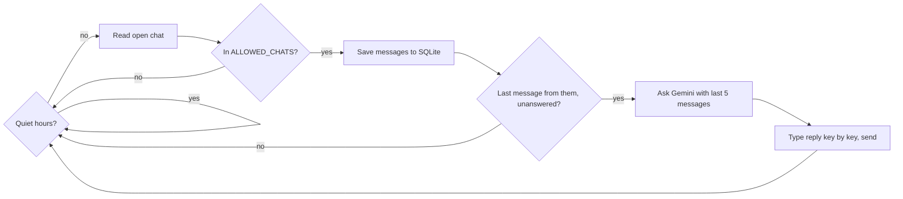

# wabot

A bot that answers WhatsApp messages for you. It watches one chat you choose, asks Gemini for a reply in your voice, and sends it.

> **Heads up:** WhatsApp can ban accounts that use automation. Test on a spare number first.

## What you need

- Python 3.11 or newer
- A [Gemini API key](https://aistudio.google.com/)
- WhatsApp on your phone

## Install

```bash
git clone https://github.com/pjha91275/Whatsapp-Reply-Bot.git
cd Whatsapp-Reply-Bot
python3.11 -m venv .venv && source .venv/bin/activate
pip install -e .
playwright install chromium
cp .env.example .env.local
cp persona.example.md persona.md
```

## Configure

Open `.env.local` and set at least these:

| Variable | Example | What it does |
|---|---|---|
| `GEMINI_API_KEY` | `AIza...` | Your Gemini key. Required. |
| `GEMINI_MODEL` | `gemini-2.5-flash` | Any Gemini model name. |
| `PERSONA_NAME` | `Budi` | Your name. Fills `{name}` in the persona. |
| `ALLOWED_CHATS` | `Budi,+62 812 3456 7890,*Santoso*` | Who the bot answers. See below. |
| `CONTEXT_MESSAGES` | `5` | How many recent messages Gemini sees. |

More options, all optional:

| Variable | Default | What it does |
|---|---|---|
| `PERSONA_FILE` | `persona.md` | Markdown file with your persona. Wins over `PERSONA_PROMPT`. |
| `PERSONA_PROMPT` | empty | Short persona text, used when the file is missing. |
| `ALLOW_GROUPS` | `false` | Answer group chats too. |
| `MATCH_THRESHOLD` | `0.85` | How close a typo may be to match a name. |
| `POLL_INTERVAL` | `4` | Seconds between checks. |
| `REPLY_DELAY_MIN` / `REPLY_DELAY_MAX` | `2` / `6` | Random pause before sending. Halved for friend chats. |
| `QUIET_HOURS` | empty | Window with no replies, such as `23:00-07:00`. Messages that arrive meanwhile get answered once it ends. |
| `TYPING_CHAR_DELAY_MS` | `70` | Pause per typed character. WhatsApp shows "typing..." while the bot types. `0` pastes instantly. |
| `MAX_TYPING_SECONDS` | `20` | Upper limit for typing one reply. Long replies type faster to fit. |
| `AFK_CHANCE` | `0.1` | Chance per incoming message that the bot goes AFK. `0` turns it off. |
| `AFK_MIN_MINUTES` / `AFK_MAX_MINUTES` | `3` / `20` | How long an AFK spell lasts. |
| `AFK_ACKNOWLEDGE` | `false` | After a long spell, Gemini may add a short "sori baru bales". |
| `AFK_ACK_MIN_MINUTES` | `5` | Shortest spell that counts as long. |
| `SKIP_BACKLOG` | `true` | Do not answer messages that were waiting before the bot started. |
| `WATCH_MODE` | `list` | `list` stays on the chat list and opens allowed chats that need an answer. `open` answers the chat you opened. |
| `OPEN_DELAY_MIN` / `OPEN_DELAY_MAX` | `1` / `4` | Random pause before opening a chat from the list. |
| `REPLY_GAP_MIN` / `REPLY_GAP_MAX` | `15` / `45` | Pause between answers to different chats. |
| `HEADLESS` | `false` | Hide the browser window. A minimized window is safer than headless. |
| `SKIP_TRIVIAL` | `true` | Ignore bare "ok", "makasih", "👍". |
| `DEBOUNCE` | `true` | Wait one poll so a burst of messages gets one reply. |
| `MAX_REPLIES_PER_HOUR` | `20` | Reply cap per chat. |
| `GEMINI_TEMPERATURE` | `0.8` | Higher means more varied replies. |
| `DB_PATH` | `wabot.db` | SQLite file with chat history. |
| `PROFILE_DIR` | `.wa-profile` | Saved WhatsApp login. |
| `BROWSER_CHANNEL` | empty | Set to `chrome` to use installed Chrome. |

### Choose who the bot answers

`ALLOWED_CHATS` takes a comma-separated list. Each entry can be:

- A name: `Budi` matches "Budi Santoso". Case and accents do not matter.
- A phone number in any format: `+62 812-3456-7890`, `0812 3456 7890` and `6281234567890` all match the same contact.
- A pattern: `*Santoso*` matches any name containing "Santoso".
- A near miss: `Budy` still matches `Budi`.
- A relationship tag after the entry: `Budi:work` or `Ani:friend`. Without a tag, the bot infers it from the chat.

An empty list means the bot answers nobody.

### Write your persona

Edit `persona.md`. It is plain Markdown, and `{name}` becomes your `PERSONA_NAME`.

```markdown
# Persona
You are {name}, a senior fullstack developer in Yogyakarta, Indonesia.

## Language
Reply in the language of the latest message: casual Indonesian by default,
professional English when the sender writes English.
```

The bundled `persona.example.md` already does this. Gemini detects the sender's language from the chat, so no extra setting exists.

## How the bot learns each chat

The bot stores messages in SQLite and builds a profile for every chat from them, with no extra Gemini calls:

- **Language, formality and message length** of the other person. Gemini receives a short note such as "work contact, mostly English, formal, they write about 12 words".
- **Your own messages.** The bot tells your hand-typed messages from its own replies, then shows Gemini your last four so it copies your voice. Type a few replies yourself in a new chat to teach it.
- **Goes AFK** now and then. On about 1 in 10 incoming messages the bot stays silent for 3 to 20 minutes, in every chat. The spell is saved in the database, so a restart does not end it early.
- **Skips** bare acknowledgements, waits for a burst of messages to finish, and stops at the hourly cap.

A new chat has no history, so the bot uses the plain persona until about 5 messages are stored. History only grows while the bot runs.

### What happens after an AFK spell

- **The bot answers on its next check.** There is no timer or special trigger. The first poll after the spell reads the chat and replies to whatever is waiting, using the last 5 messages. If the sender wrote several messages meanwhile, they get one reply.
- **No back-to-back spells.** The first reply after a spell never rolls for another one.
- **A late reply can mention the delay.** With `AFK_ACKNOWLEDGE=true` and a spell of at least `AFK_ACK_MIN_MINUTES`, Gemini may add a short phrase such as "sori baru bales" in the sender's language.
- **If you answer by hand first,** the bot sees your message and stays quiet.
- **If the sender never writes again,** the bot answers once after the spell, then sends nothing more. It never follows up or nudges.
- **The chat must be in the visible list.** WhatsApp only renders the rows near the top. A waiting chat that has scrolled out of view cannot be opened, and the bot logs a warning.
- **Restarts skip old messages.** With `SKIP_BACKLOG=true`, a message that was already waiting when the bot started gets no reply. The exception is a message that caused a spell still running at restart, which the bot answers after the spell.

### Several messages at once

The bot handles one chat at a time. If two chats get a message within a few seconds:
- It answers the one that arrived first.
- It waits `REPLY_GAP_MIN` to `REPLY_GAP_MAX` seconds, then opens and answers the second one. The second chat stays unread until its turn.
- Every message rolls the AFK dice on its own turn. A spell pauses the whole queue, and the waiting chats are answered after it ends.
- A follow-up in the chat you just answered is not held back by the gap.

## Log in once

```bash
python -m wabot --login
```

A browser window opens with a QR code. On your phone, go to WhatsApp, then Settings, then Linked Devices, then Link a Device, and scan it. The session stays saved in `.wa-profile/`.

## Try it safely

```bash
python -m wabot --dry-run
```

Open the chat you want to test in the browser window. The bot prints replies in the terminal and sends nothing.

## Run it

```bash
python -m wabot
```

Leave the window on the chat list. The bot opens a chat only when it is in `ALLOWED_CHATS` and has a message waiting, answers, then returns to the list. Chats outside the list are never opened, read or answered. Press Ctrl+C to stop.

To answer whichever chat you open yourself, set `WATCH_MODE=open`.



## Lower the ban risk

WhatsApp can ban accounts that automate messages, and no setting removes that risk. These steps help:

- Answer only people who wrote to you first, and keep `ALLOWED_CHATS` short.
- Keep the bot on the chat list. It never opens chats outside the allowlist.
- Set `QUIET_HOURS` so the bot sleeps at night.
- Keep `AFK_CHANCE` above 0 so the bot sometimes goes away for a few minutes, like a person would.
- Keep the typing pause on (`TYPING_CHAR_DELAY_MS`) so replies look typed.
- Lower `MAX_REPLIES_PER_HOUR` to 6 to 10 and raise `REPLY_DELAY_MAX` to about 40.
- Use an established number, not a new SIM.
- Set `BROWSER_CHANNEL=chrome` and run the bot from the same machine each time.
- Never use it for bulk or marketing messages.

## Troubleshooting

- **"session expired":** run `python -m wabot --login` again.
- **The bot never replies:** the chat title probably does not match `ALLOWED_CHATS`. Run with `--dry-run` and read the log.
- **Gemini error "fatal":** check `GEMINI_API_KEY` and `GEMINI_MODEL`.
- **WhatsApp says the browser is unsupported:** set `BROWSER_CHANNEL=chrome`.
- **The bot never opens a chat:** the title in the chat list must match an `ALLOWED_CHATS` entry, and the row must be unread or have a waiting message. A group stays unanswered unless `ALLOW_GROUPS=true`.
- **Nothing is read from the chat:** WhatsApp changed its page. Update `src/wabot/whatsapp/selectors.py`.

To read stored history: `sqlite3 wabot.db "select sender, text from messages order by id desc limit 10"`.

## Keep private

Never share `.env.local`, `.wa-profile/`, `wabot.db` or `persona.md`. They hold your key, your login, your chats and a profile of each contact. WhatsApp also logs out linked devices if your phone stays offline for about 14 days.

## Develop

```bash
pip install -e ".[dev]"
pytest && ruff check . && mypy src
```
